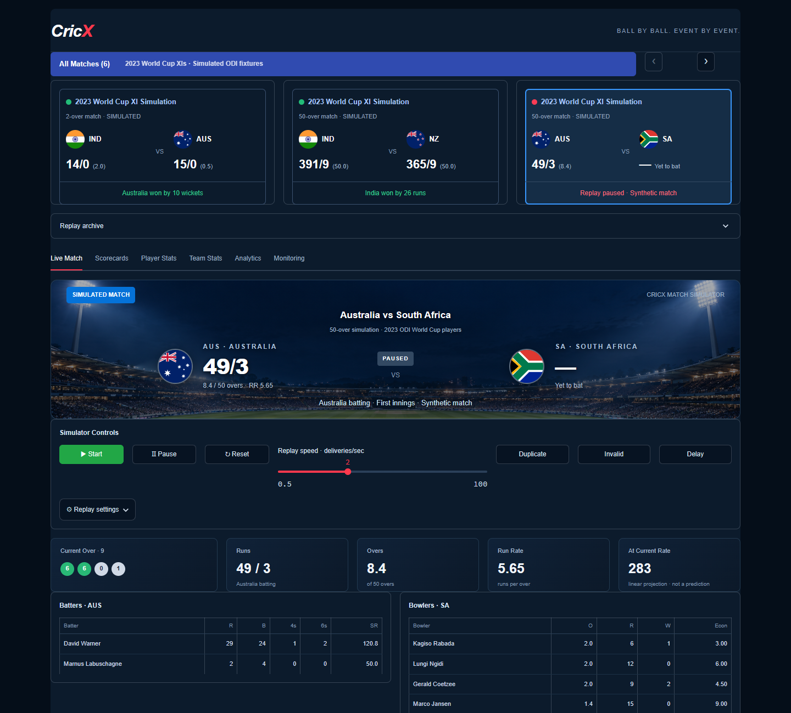

# CricX

A ball-by-ball cricket simulator built with Kafka, PySpark Structured Streaming,
PostgreSQL and Streamlit. Matches use selected 2023 World Cup XIs.




[Full screenshots](screenshots/README.md)

## What it does

- Simulates six ODI fixtures with start, pause and resume controls.
- Shows scorecards, player statistics, team statistics and match analytics.
- Handles duplicate, late and corrected deliveries without inflating scores.
- Tracks processing, backlog and failures with Prometheus, Grafana and alerts.

**Pipeline:** Python → Kafka → Spark → PostgreSQL → Streamlit.

## Run

Start Docker Desktop with Linux containers. Copy `.env.example` to `.env` and
replace both placeholder passwords with URL-safe random values. Keep `.env` private.

```powershell
docker compose up -d --build
```

| App | Address |
| --- | --- |
| Dashboard | http://localhost:8501 |
| Grafana | http://localhost:3000 |
| Prometheus | http://localhost:9090 |

Grafana username: `admin`. Password: the value in `.env`.

Choose a match in the dashboard and press **Start**. Only one replay runs at a time.
Other match cards show saved scores. To populate the five additional fixtures:

```powershell
docker compose exec dashboard python -m experiments.seed_match_gallery
```

## Tests

Python, producer and PostgreSQL tests:

```powershell
docker compose --profile tools run --rm --build test
```

Spark tests, with PostgreSQL running:

```powershell
docker compose build spark
docker compose run --rm --no-deps spark /opt/spark/bin/spark-submit --master local[2] --driver-memory 512m tests/run_spark_tests.py
```

Latest local results: **23 tests passed** in the first suite, with four Spark tests
skipped. Those **four Spark tests passed separately**. CI runs Python and PostgreSQL
tests; Spark tests are not in CI.

## Design and limits

Corrections replace the accepted delivery and rebuild the affected innings in one
PostgreSQL transaction. Spark computes over summaries and checks them against the
Python scorer before commit. Late deliveries can update scores even when the
separate watermarked feed-activity query drops them.

This is a small demo: one Kafka broker, replication factor 1, Spark `local[2]`,
driver-side validation and serial database writes. It does not demonstrate host
failover, large-scale performance or end-to-end exactly-once processing. Sequence
gaps produce provisional scores; full cricket-law validation and DLS are not supported.

The project has been tested in local Docker only. Cloud deployment is pending.
Published ports bind to localhost. No paid services are used by the current setup.

## Stop

```powershell
docker compose down
```

This preserves data and checkpoints. Use `docker compose down -v` only when you
intend to **delete this project's data and checkpoints**.

AI tools helped with the code, documentation and testing.
