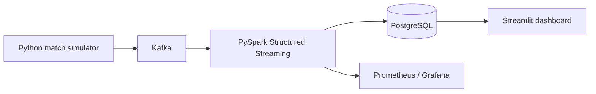

# CrickX

A local streaming-systems project that simulates ball-by-ball ODI data and turns it into scorecards, player statistics, team statistics, and match analytics.

The stack is deliberately small: Python produces delivery events, Kafka carries them, PySpark Structured Streaming processes them, PostgreSQL stores the result, and Streamlit presents it.


## Pipeline




[Full screenshots](screenshots/README.md)

## Why this project exists

Streaming data is less interesting when every event arrives once and in order. This project is built around the awkward cases: duplicate deliveries, late deliveries, corrections, and temporary sequence gaps.

A corrected delivery replaces the accepted event and rebuilds the affected innings in one PostgreSQL transaction. That keeps a corrected score from being counted twice. The monitoring path is intentionally separate from score processing, so late events can still update a score even when the watermarked activity view no longer includes them.

## Tech highlights

- Kafka-backed delivery event stream
- PySpark Structured Streaming for event processing
- PostgreSQL scorecards and statistics
- Python scorer checks before database writes
- Prometheus, Grafana, and alerts for processing, backlog, and failures
- Docker Compose environment for the simulator, broker, Spark, database, dashboard, and monitoring

## What it does

- Simulates six ODI fixtures with start, pause, and resume controls.
- Shows scorecards, player statistics, team statistics, and match analytics.
- Handles duplicate, late, and corrected deliveries without inflating scores.
- Tracks processing, backlog, and failures with Prometheus, Grafana, and alerts.

## Run

Start Docker Desktop with Linux containers. Copy `.env.example` to `.env` and replace both placeholder passwords with URL-safe random values. Keep `.env` private.

```powershell
docker compose up -d --build
```

| App | Address |
| --- | --- |
| Dashboard | http://localhost:8501 |
| Grafana | http://localhost:3000 |
| Prometheus | http://localhost:9090 |

Grafana username: `admin`. Password: the value in `.env`.

Choose a match in the dashboard and press **Start**. Only one replay runs at a time. Other match cards show saved scores. To populate the five additional fixtures:

```powershell
docker compose exec dashboard python -m experiments.seed_match_gallery
```

## Tests

Python, producer, and PostgreSQL tests:

```powershell
docker compose --profile tools run --rm --build test
```

Spark tests, with PostgreSQL running:

```powershell
docker compose build spark
docker compose run --rm --no-deps spark /opt/spark/bin/spark-submit --master local[2] --driver-memory 512m tests/run_spark_tests.py
```

The first suite currently has 23 passing tests; four Spark tests are run separately. CI covers the Python and PostgreSQL suite.

## Scope and limits

This is a local demo, not a production deployment: it uses one Kafka broker, replication factor 1, Spark `local[2]`, driver-side validation, and serial database writes. It does not cover host failover, high-throughput performance, or end-to-end exactly-once guarantees. Sequence gaps produce provisional scores; full cricket-law validation and DLS are out of scope.

To stop the stack:

```powershell
docker compose down
```

This preserves data and checkpoints. Use `docker compose down -v` only when you intend to delete the project's data and checkpoints.
