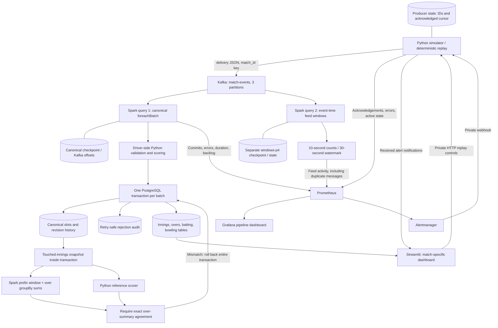

# Architecture and interview explanation

## Two queries, two meanings

**Canonical query:** valid events reach the PostgreSQL ledger even when old.
A slot is `(match_id, innings_number, raw_delivery_sequence)`. Identical deliveries
are skipped; higher revisions replace the current payload and preserve history;
stale or conflicting revisions are audited. Touched innings are rebuilt inside
the same transaction. The scoreboard reads these committed tables.

**Canonical over aggregation:** after revision acceptance, the sink reuses its
existing ledger SELECT for each touched innings. `spark/over_aggregation.py`
projects these validated, unique current slots into a finite batch DataFrame.
An ordered prefix window counts preceding legal deliveries; integer over index
is `floor(legal_before / 6)`, including wides/no-balls in the same over as the
reference scorer. Spark groups by match, innings and this zero-based over, then
sums runs (batter + all extras), wickets and legal balls. Only aggregate rows
return to the driver for comparison and SQL writes. No Python UDF is used.

The production `foreachBatch` passes this aggregation to `persist`. Its output
must exactly equal the Python reference over summaries before any serving
rebuild commits. Spark output supplies the existing `over_summary` table;
innings/batting/bowling scoring remains Python. A mismatch or Spark exception
rolls back ledger, history, rejection audit and serving changes together. Direct
non-Spark callers retain the existing reference-only behavior; production never
silently falls back after failure. PostgreSQL's committed scorecards remain the
authority; this is not a separate independently maintained scoreboard.

Duplicates and rejected-only batches do no aggregation. Corrections rebuild the
entire affected innings, because changing legality can shift later over boundaries.
Out-of-order slots are ordered by raw sequence. Accepted late events still rebuild
scores regardless of the analytics watermark; gaps remain provisional under the
existing scorer. The batch transformation has no cross-batch in-memory state or
new streaming query/checkpoint. `/checkpoints/canonical` and
`/checkpoints/windows-p4` remain unchanged; old `/checkpoints/windows` is retained.

**Window query:** Spark groups parsed feed messages by event time and match.
It counts messages, including duplicates and revisions. Its watermark bounds
state and can discard late records. Counts are operational metrics, not unique
runs or score totals. It has no durable business-analytics sink.

## What recovery guarantees

Spark checkpoints track source progress, separately for each query. A failed
PostgreSQL transaction rolls back ledger and serving changes together. Retrying
a batch checks existing slots and audit source keys. A crash after commit but
before checkpoint progress can cause replay, which the sink tolerates. This is
idempotent database effect handling, not an end-to-end exactly-once claim.

Producer cursor persistence can also resend an acknowledged event after a crash.
Restart pauses the simulator for explicit resume. Checkpoints, database data and
producer state live in Docker volumes; deleting those volumes changes recovery.

## Limits and what would change at 100 times the load

| Current limit | Change to investigate after learning the current design |
| --- | --- |
| Kafka batches (maxOffsetsPerTrigger 1000), ledger snapshots and reference scoring still use the driver | Measure memory and SQL costs before moving additional correction-aware computations |
| Spark over aggregation runs while PostgreSQL locks are held, alongside the reference calculation | Profile job startup/shuffles and transaction duration; this change does not promise better throughput |
| Per-event SQL and full touched-innings rebuild | Measure query/lock costs; batch ledger lookups and writes before changing the transaction model |
| One Kafka broker, Spark `local[2]`, one PostgreSQL instance | Design replication, distributed compute and database availability; this demo has no host failover |
| Synthetic finite inputs and global event-time watermark | Use an isolated, licensed replay with controlled disorder and timestamps; measure state, skew and backlog |
| A Prometheus label per match, including past matches | Bound metric cardinality or move match history to a durable analytics store |

These are proposed investigations, not implemented scaling claims. No new stack,
warehouse or cloud deployment is required for the present learning milestone.

Snapshots are finite per invocation, but their size scales with all history in
touched innings, not just the 1000 new Kafka offsets. Ordered window and aggregate
operations require sorting/shuffles. PostgreSQL access and writes remain serial,
and execution is still Spark `local[2]`; DataFrame APIs alone do not establish
distributed scalability. Old serving rows are not migrated automatically: they
remain valid reference results until a new accepted event touches that innings.

Executed validation and reproduction commands are recorded in
[the Spark over experiment](../experiments/spark_over_aggregation.md).
