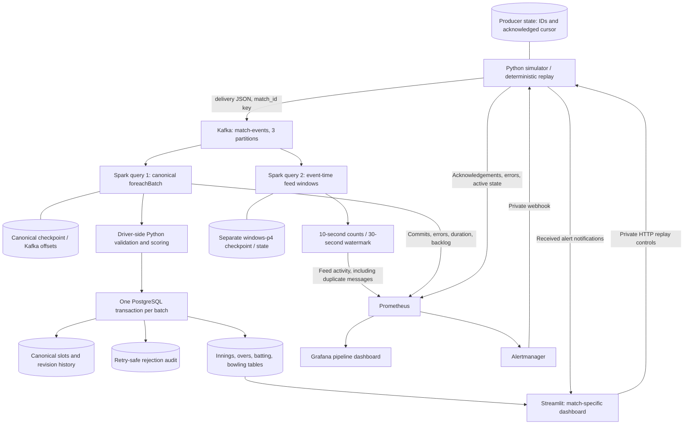

# Architecture and interview explanation

## Two queries, two meanings

**Canonical query:** valid events reach the PostgreSQL ledger even when old.
A slot is `(match_id, innings_number, raw_delivery_sequence)`. Identical deliveries
are skipped; higher revisions replace the current payload and preserve history;
stale or conflicting revisions are audited. Touched innings are rebuilt inside
the same transaction. The scoreboard reads these committed tables.

**Window query:** Spark groups parsed feed messages by event time and match.
It counts messages, including duplicates and revisions. Its watermark bounds
state and can discard late records. Counts are operational metrics, not unique
runs or score totals. It has no durable business-analytics sink.

## What recovery guarantees

Spark checkpoints track source progress, separately for each query. A failed
PostgreSQL transaction rolls back ledger and serving changes together. Retrying
a batch checks existing slots and audit source keys. A crash after commit but
before checkpoint progress can cause replay, which the sink tolerates. This is
idempotent database effect handling, not an end-to-end exactly-once claim.

Producer cursor persistence can also resend an acknowledged event after a crash.
Restart pauses the simulator for explicit resume. Checkpoints, database data and
producer state live in Docker volumes; deleting those volumes changes recovery.

## Limits and what would change at 100 times the load

| Current limit | Change to investigate after learning the current design |
| --- | --- |
| Scoring gathers each batch on the Spark driver | Define correction-aware distributed business aggregates and compare their results with the reference scorer |
| Per-event SQL and full touched-innings rebuild | Measure query/lock costs; batch ledger lookups and writes before changing the transaction model |
| One Kafka broker, Spark `local[2]`, one PostgreSQL instance | Design replication, distributed compute and database availability; this demo has no host failover |
| Synthetic finite inputs and global event-time watermark | Use an isolated, licensed replay with controlled disorder and timestamps; measure state, skew and backlog |
| A Prometheus label per match, including past matches | Bound metric cardinality or move match history to a durable analytics store |

These are proposed investigations, not implemented scaling claims. No new stack,
warehouse or cloud deployment is required for the present learning milestone.
