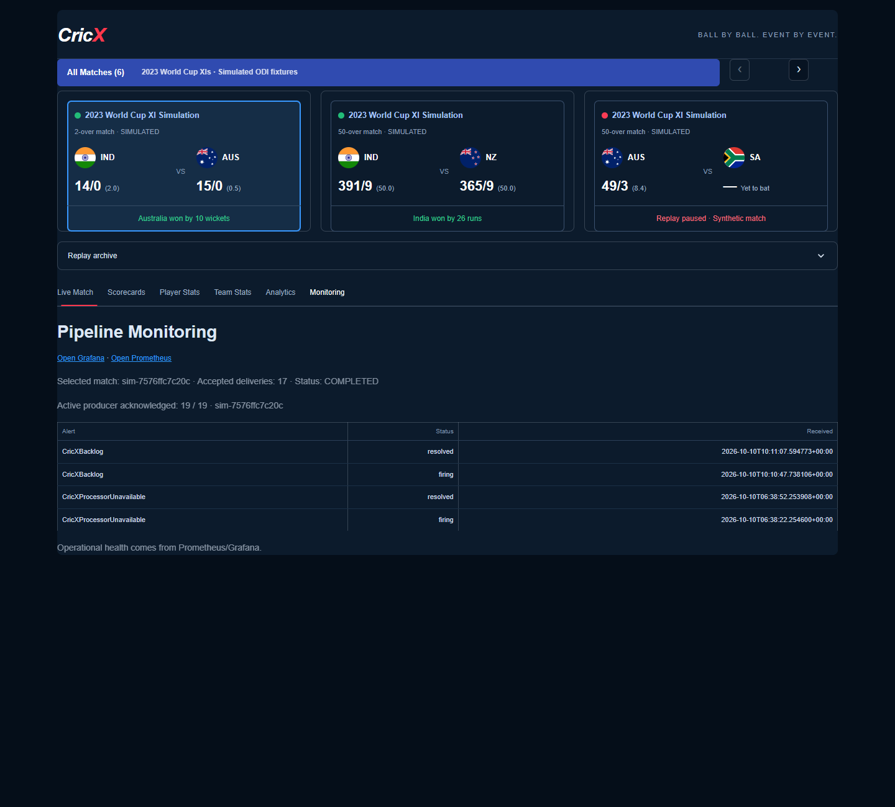
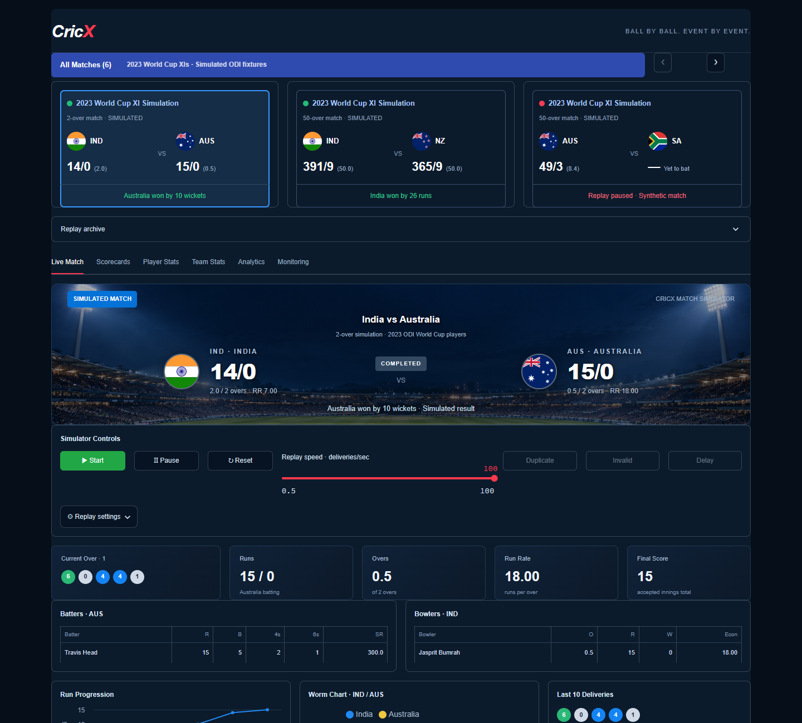
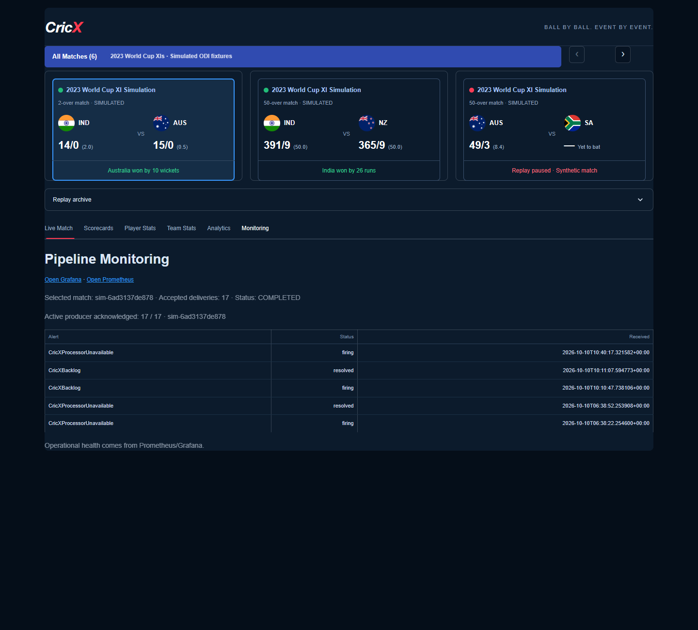

# Demo and recorded results

All screenshots below were captured from the running local Docker stack on
2026-10-10. They show synthetic cricket data. Assertions and recorded JSON provide
correctness evidence; an image alone does not prove deduplication or recovery.

## Five-minute explanation

1. Open the [dashboard](http://localhost:8501). Click a fixture, then use the arrows
   to inspect the other three. Scorecards, players and analytics use that match ID.
2. Explain the two paths using the [architecture diagram](architecture.md).
   Canonical scores accept corrections and late events; watermarked windows count
   feed messages and have separate checkpoints.
3. Show the duplicate experiment: 19 Kafka-acknowledged messages, 17 canonical
   deliveries, one invalid audit row. Two innings remain 14/0 and 15/0.
4. Show the outage and restored scorecard. PostgreSQL was stopped while a new
   finite replay entered Kafka; restored processing committed all 17 deliveries.
5. Show the newly routed processor-down alert and describe the known scaling limits.

## Recorded results

| Check | Observed result |
| --- | --- |
| Regression tests | 18 passed: 13 pure Python, 5 real PostgreSQL |
| Duplicate + invalid + delayed delivery | 19 messages → 17 canonical deliveries, one invalid audit row |
| Innings 1 | 14/0, 12 legal balls, one extra |
| Innings 2 | 15/0, five legal balls, zero extras |
| Database outage recovery | All 17 queued deliveries committed; the same expected innings totals |
| Further Spark restart | Existing canonical counts and scores unchanged |
| Monitoring | Fresh `CricXProcessorUnavailable` firing notification received by the private webhook |

Machine-readable results: [recorded demo JSON](evidence/demo-2026-10-10.json).
Historical burst and event-time measurements remain in
[the simulator experiment report](../experiments/simulator_validation.md);
they are separate observations, not measurements of this demo.

## Screenshots

**Duplicate and invalid events**

The Monitoring tab displays both acknowledged sends and accepted deliveries for
the selected synthetic match. The verifier additionally compares committed scores
with the reference scorer and asserts the audit row count.



**Recovered scorecard**



**Processor-down alert**

The verifier requires a firing notification newer than the recorded start of this
experiment, so a historical alert cannot satisfy the check.



## Reproduce the demo

These commands temporarily stop this project's PostgreSQL and Spark services.
Run them when interrupting the local demo is acceptable. Keep data/checkpoint
volumes: do not use `down -v` for recovery. Both services must be restored even if
an assertion or screenshot step fails.

```powershell
# Existing stack required. The script saves the current replay ID/cursor.
docker compose exec -T dashboard python -m experiments.record_demo duplicate

# Queue a finite match while PostgreSQL is unavailable.
docker compose stop postgres
docker compose exec -T dashboard python -m experiments.record_demo queue-recovery
# Open dashboard to observe its unavailable-score message.
docker compose start postgres
docker compose exec -T dashboard python -m experiments.record_demo verify-recovery

docker compose restart spark
docker compose exec -T dashboard python -m experiments.record_demo verify-restart

# Wait for a newly routed firing notification, not a past one.
docker compose exec -T dashboard python -m experiments.record_demo mark-alert
docker compose stop spark
docker compose exec -T dashboard python -m experiments.record_demo verify-alert
# Capture Monitoring tab before restoring the processor.
docker compose start spark

# Restore the original replay paused, preserving its cursor and rate.
docker compose exec -T dashboard python -m experiments.record_demo restore
```

Evidence accumulates in `/tmp/cricx-demo.json` inside the dashboard container.
A container recreation removes that temporary file. Start from a fresh dashboard
container for a separate demo session. The scorer is the same reference model as
the sink; independent fixed expected totals and SQL transaction tests provide
additional coverage; comparison with the same scorer is not an independent proof.

Recovery retries may briefly leave Spark unavailable; the verifier waits up to
120 seconds for committed scores. This does not establish an RTO or SLA. The
producer is intentionally paused after restoration, and only one replay publishes
at a time. There are no external alert messages, API purchases or cloud resources.
