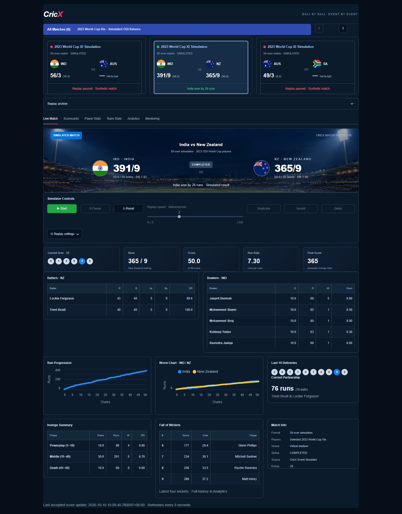
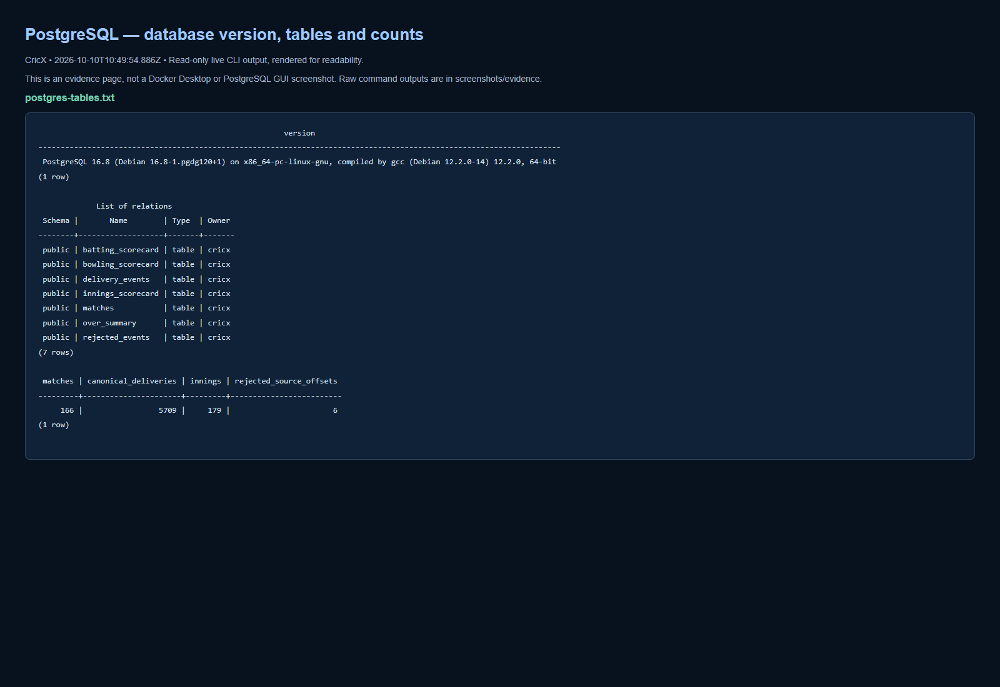
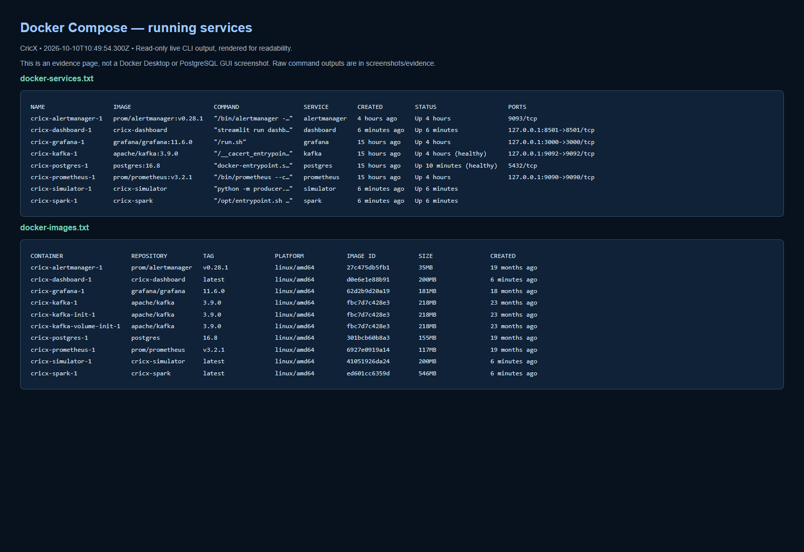
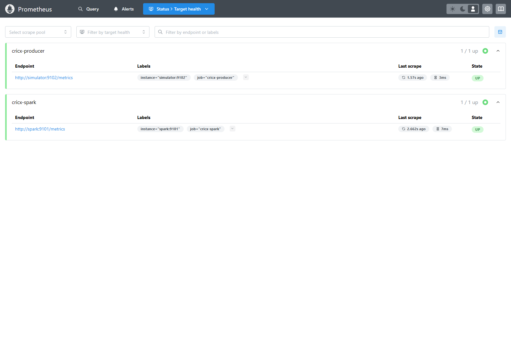
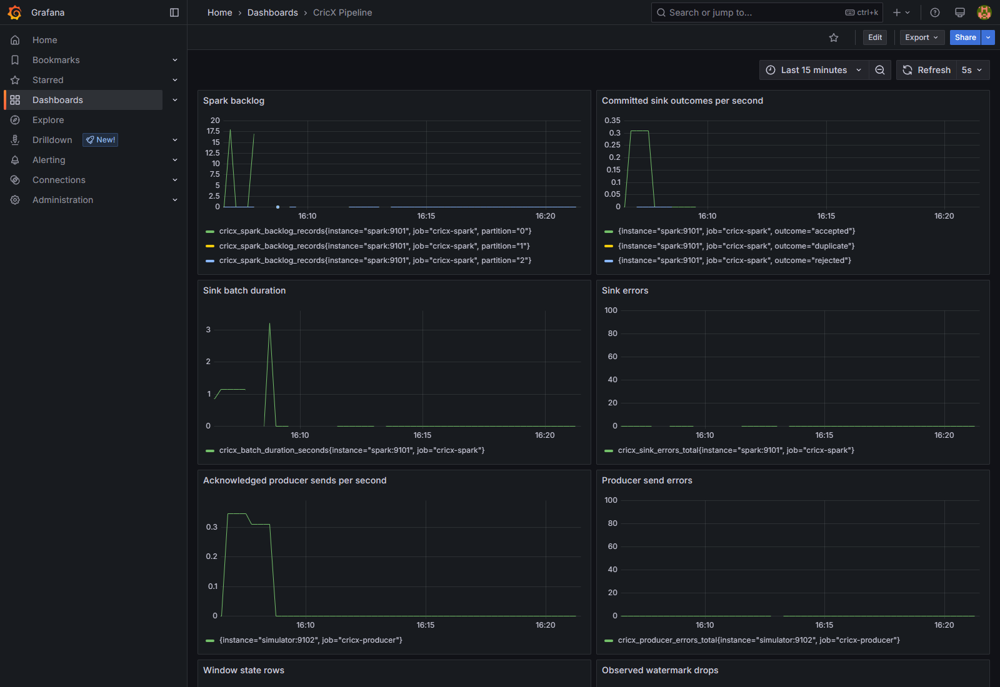

# CricX screenshots

Recaptured from the running local Docker stack on 2026-10-10 after the five-tab dashboard redesign. The primary Streamlit captures show the completed India–New Zealand simulation so both innings and the redesigned charts are visible. Cricket outcomes are synthetic. These snapshots are evidence of the captured state, not a cloud deployment or a performance benchmark.

**Capture types:** Streamlit, Prometheus and Grafana images are actual browser UI screenshots. Docker, PostgreSQL, Kafka and Spark evidence images render unmodified live command output for readability; they are not screenshots of Docker Desktop, pgAdmin or Spark UI. Raw outputs are retained in [evidence](evidence).

| Area | Screenshot | Description |
| --- | --- | --- |
| Docker | [docker-services.png](docker-services.png) | Running services and image versions. |
| Docker | [docker-resources.png](docker-resources.png) | Container CPU and memory snapshot. |
| Postgres | [postgres-schema.png](postgres-schema.png) | PostgreSQL version and tables. |
| Postgres | [postgres-scorecards.png](postgres-scorecards.png) | Stored innings scores. |
| Streamlit | [streamlit-live-match.png](streamlit-live-match.png) | Live Match tab, completed India–New Zealand saved simulation |
| Streamlit | [streamlit-scorecards.png](streamlit-scorecards.png) | Actual Streamlit Scorecards tab |
| Streamlit | [streamlit-player-stats.png](streamlit-player-stats.png) | Actual Streamlit Player Stats tab |
| Streamlit | [streamlit-team-stats.png](streamlit-team-stats.png) | Actual Streamlit Team Stats tab |
| Streamlit | [streamlit-analytics.png](streamlit-analytics.png) | Actual Streamlit Analytics tab |
| Streamlit | [streamlit-monitoring.png](streamlit-monitoring.png) | Actual Streamlit Monitoring tab |
| Streamlit | [streamlit-match-gallery-page2.png](streamlit-match-gallery-page2.png) | Second gallery page and selected India vs South Africa replay |
| Prometheus | [prometheus-targets.png](prometheus-targets.png) | Actual Prometheus scrape targets |
| Prometheus | [prometheus-alerts.png](prometheus-alerts.png) | Actual Prometheus alert rules and current states |
| Prometheus | [prometheus-up-query.png](prometheus-up-query.png) | Actual Prometheus query for target availability |
| Kafka | [kafka-topic.png](kafka-topic.png) | Read-only live command/metrics output rendered in a browser. |
| Spark | [spark-metrics.png](spark-metrics.png) | Read-only live command/metrics output rendered in a browser. |
| Grafana | [grafana-pipeline.png](grafana-pipeline.png) | Actual Grafana pipeline metrics dashboard (viewport capture) |

## Capture details

UTC capture times are in [capture-index.json](capture-index.json). All captures are read-only; no simulation was started or reset. Viewing a saved match changes only that browser session. Passwords and private configuration files are excluded. Historical firing/resolved alerts are explicitly labelled in the Monitoring tab; Prometheus shows current rule state.

The Docker service image lists eight running services. The PostgreSQL snapshot includes seven tables and historical synthetic experiment records. Database totals include old replay and burst experiments, not just the six fixtures visible in the gallery.

Commands used for the raw evidence:

```powershell
docker compose ps
docker compose images
docker stats --no-stream cricx-kafka-1 cricx-spark-1 cricx-postgres-1 cricx-simulator-1 cricx-dashboard-1 cricx-prometheus-1 cricx-grafana-1 cricx-alertmanager-1
docker compose exec -T postgres psql -U cricx -d cricx -P pager=off -c "SELECT version();" -c "\dt"
docker compose exec -T postgres psql -U cricx -d cricx -P pager=off -c "SELECT match_id,innings_number,runs,wickets,legal_balls,extras FROM innings_scorecard ORDER BY updated_at DESC LIMIT 12;"
docker compose exec -T kafka /opt/kafka/bin/kafka-topics.sh --bootstrap-server localhost:29092 --describe --topic match-events
```

Spark metrics were retrieved read-only from `http://spark:9101/metrics` inside the Docker network. Dashboard URLs: `localhost:8501`, `localhost:9090`, and `localhost:3000`. The resource snapshot is instantaneous and should not be presented as sustained capacity.

## Selected previews

**Streamlit**



**PostgreSQL**



**Docker**



**Prometheus**



**Grafana**


